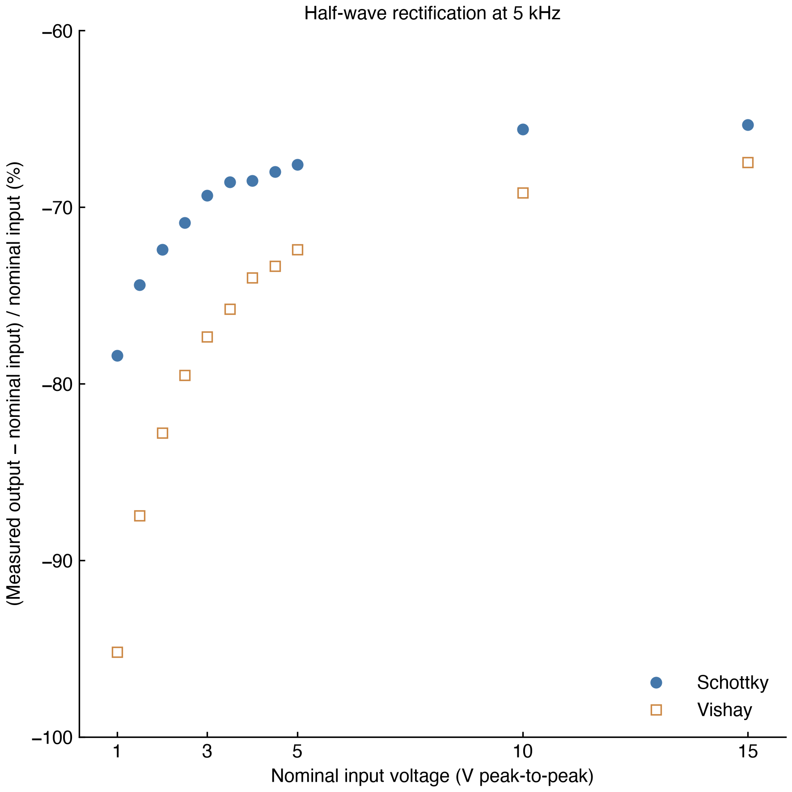

# PHYS 2210 Oscilloscope

## Diode plots

Saved experimental figures are in [`analysis/`](analysis/). Each figure is available as PNG, SVG, and PDF, with CSV source tables and Python plotting scripts beside it.

| Figure | Preview | PDF |
| --- | --- | --- |
| Schottky vs. Vishay: relative voltage difference vs. nominal input | [PNG](analysis/2026-11-12_schottky_vishay/relative_difference.png) | [PDF](analysis/2026-11-12_schottky_vishay/relative_difference.pdf) |
| Schottky vs. Vishay: measured output vs. nominal input | [PNG](analysis/2026-11-12_schottky_vishay/output_vs_input.png) | [PDF](analysis/2026-11-12_schottky_vishay/output_vs_input.pdf) |
| 120 Ω load current vs. load voltage | [PNG](analysis/2026-11-12_120ohm/load_iv_120ohm.png) | [PDF](analysis/2026-11-12_120ohm/load_iv_120ohm.pdf) |
| Three-diode measured output vs. nominal input | [PNG](analysis/2026-11-12_120ohm/output_vs_input.png) | [PDF](analysis/2026-11-12_120ohm/output_vs_input.pdf) |
| Output voltage vs. frequency | [PNG](analysis/2026-11-12_120ohm/voltage_vs_frequency.png) | [PDF](analysis/2026-11-12_120ohm/voltage_vs_frequency.pdf) |
| Combined three-panel figure | [PNG](analysis/2026-11-12_120ohm/today_diagrams.png) | [PDF](analysis/2026-11-12_120ohm/today_diagrams.pdf) |

The normalized two-diode figure uses **100 × (measured output − nominal input) / nominal input (%)**. Both voltages are peak-to-peak; nominal input comes from the generator setting recorded in each capture folder name. The two-diode comparison includes 11 Schottky and 11 Vishay captures at nominal 5 kHz.



The 120 Ω figures preserve an earlier 31-capture snapshot, including 13 `in4007` captures whose raw files are unavailable in this checkout. Reproduce that snapshot from its included summary CSV. The [two-diode notes](analysis/2026-11-12_schottky_vishay/README.md) and [120 Ω notes](analysis/2026-11-12_120ohm/README.md) describe the measurements and selection rules. Saved CSV paths, provenance, and audit records retain their original local source locations.

### Reproduce the figures

From the repository root, install the plotting dependencies and run:

```bash
python3.12 -m venv .venv
.venv/bin/python -m pip install -r requirements-analysis.txt
.venv/bin/python analysis/2026-11-12_schottky_vishay/plot_output_vs_input.py
.venv/bin/python analysis/2026-11-12_schottky_vishay/plot_relative_difference.py
.venv/bin/python analysis/2026-11-12_120ohm/plot_diagrams.py --resistance-ohm 120 --from-summary
```

These commands overwrite the corresponding generated figures and tables. Font choice follows locally available fonts; the committed figures use Helvetica.

## Capture waveforms

Standalone **Python 3.12** script for fetching Tektronix **TBS2074B** waveforms and measurements over Ethernet. Requires only `python-vxi11` plus Python's standard library.

Connect your computer to the scope's network, enable the desired channels, and set the correct probe factors. Replace `SCOPE_IP` with the address shown on the scope:

```bash
python3.12 -m venv .venv
.venv/bin/python -m pip install python-vxi11==0.9
.venv/bin/python capture.py --host SCOPE_IP
```

Add `--channels CH1 CH2` to select channels or `--output ./my_capture` to choose a new output folder. By default, CSVs, raw responses, and metadata go to `data/<timestamp>/` beside the script.

Press **Stop** on the scope first if channels must share a stopped acquisition; running acquisitions are read sequentially. The script preserves acquisition settings and restores its temporary transfer/measurement settings.

## USB on Windows

The standalone `capture_usb.py` uses the vendor VISA backend (`ivi`) by default on
Windows. Install a Windows VISA runtime with USB support, such as
[NI-VISA](https://www.ni.com/en/support/downloads/drivers/download.ni-visa.html),
if one is not already installed. PyVISA alone does not install the instrument
driver. Match the VISA library and Python architecture (usually 64-bit).

Connect the laptop to the scope's rear USB device port. In PowerShell, from the
folder containing `capture_usb.py`, create an environment with Python 3.12:

```powershell
py -3.12 -m venv .venv
.\.venv\Scripts\python.exe -m pip install pyvisa
.\.venv\Scripts\python.exe capture_usb.py --list
.\.venv\Scripts\python.exe capture_usb.py --identify
```

`--list` enumerates USB VISA resource names. `--identify` sends only `*IDN?` and
prints the instrument identity; neither creates a capture directory or changes
acquisition/transfer settings. If several Tektronix USB instruments are present,
copy the intended address from `--list` and pass `--resource "USB0::...::INSTR"`.

Once identification succeeds, enable the channels to export and set their probe
factors on the scope:

```powershell
.\.venv\Scripts\python.exe capture_usb.py --channels CH1
.\.venv\Scripts\python.exe capture_usb.py --channels CH1 CH2 --output .\my_capture
```

Each invocation saves a new capture. The output folder must not already exist.
The default channel is CH1. Default output is `data/<timestamp>/` beside the script:

- `CH1_waveform.csv` (and each requested channel): time in seconds, voltage in volts, ADC code.
- `waveforms.csv`: combined channels when their time axes match.
- `measurements.csv`: frequency, period, peak-to-peak, RMS, mean, minimum, maximum.
- Raw instrument responses and `metadata.json`, including model, VISA backend,
  scaling, acquisition state, and restoration results.

For channels from one stopped acquisition, press **Stop** on the scope before
capture. The script does not stop, restart, autoset, or reset acquisition; running
channels and measurements are fetched sequentially and can describe different
records. Temporary waveform-transfer and immediate-measurement settings are restored.

The model check accepts the TBS2072B, TBS2074B, TBS2102B, TBS2104B, TBS2202B, and
TBS2204B and checks only the analog channels that exist on that model.
`MATH` remains available for time-domain traces in seconds and volts; other units
(such as FFT output) are rejected by the existing waveform parser.
The Windows adaptation and additional model handling still require verification
on an actual instrument.

If the backend cannot load, check the VISA runtime installation and architecture.
If no USB instrument appears, check power, the USB device-port connection, and
Windows Device Manager or the VISA vendor's instrument utility.
A timeout during identification usually needs connection/driver investigation.
For a large waveform transfer, the default timeout is 60 seconds; it can be raised
with `--timeout-ms 120000`.

## USB on macOS/Linux

The existing `pyvisa-py` backend remains the default outside Windows:

```bash
python3.12 -m venv .venv
.venv/bin/python -m pip install pyvisa pyvisa-py pyusb libusb-package
.venv/bin/python capture_usb.py --identify
.venv/bin/python capture_usb.py --channels CH1
```

USB access permissions and a suitable USB driver/backend are still required.
You can explicitly choose `--backend py` or `--backend ivi`; selecting `py` on
Windows requires separately configured libusb-compatible device access.

References: [PyVISA installation](https://pyvisa.readthedocs.io/en/latest/introduction/getting.html),
[backend selection](https://pyvisa.readthedocs.io/en/latest/introduction/configuring.html),
[TBS2000B programmer manual](https://download.tek.com/manual/TBS2000B-Programmer-Manual-EN-US-077114904.pdf).
